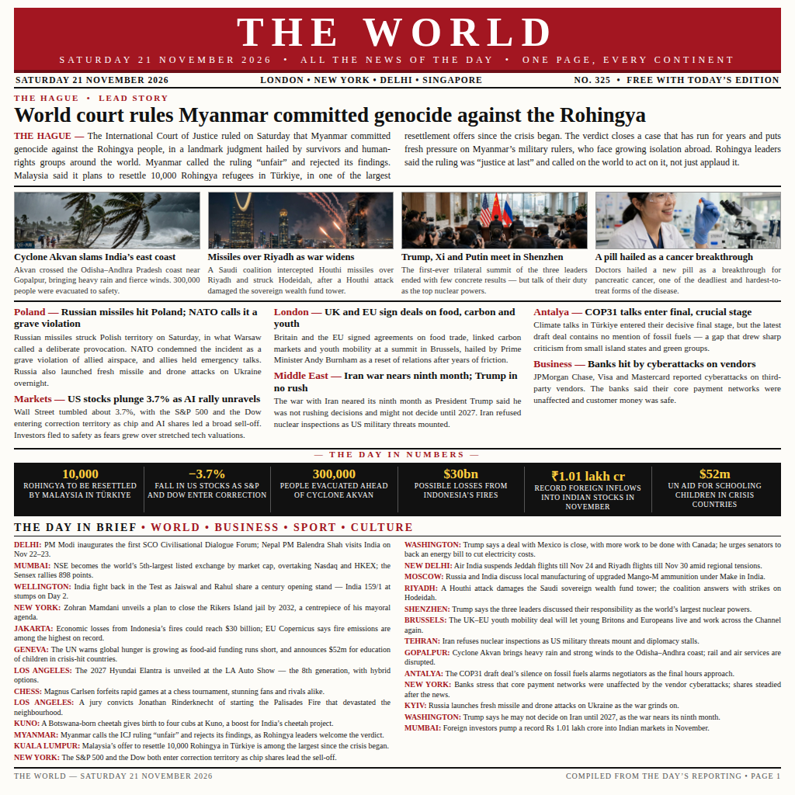

[](https://make.fun/bounty/news-image-20261121?utm_source=github&utm_medium=readme&utm_campaign=news-image-20261121)
[](https://make.fun/bounty/news-image-20261121/leaderboard?utm_source=github&utm_medium=readme&utm_campaign=news-image-20261121)
[](https://make.fun/bounty/news-image-20261121?utm_source=github&utm_medium=readme&utm_campaign=news-image-20261121)

# THE WORLD — Saturday 21 November 2026

A one-page newspaper front page summing up the world's news of Saturday
21 November 2026, built for the make.fun competition
[news-image-20261121](https://make.fun/bounty/news-image-20261121)
($100 total, top 50 paid).



## What's on the front page

- **Lead:** the International Court of Justice rules Myanmar committed
  genocide against the Rohingya; Malaysia plans to resettle 10,000
  Rohingya in Türkiye.
- **Photo stories:** Cyclone Akvan hits India's east coast (300,000
  evacuated), Houthi missiles intercepted over Riyadh, the first-ever
  Trump–Xi–Putin trilateral summit in Shenzhen, and a pill hailed as a
  breakthrough for pancreatic cancer.
- **Top stories:** Russian missiles hit Poland (NATO calls it a grave
  violation), US stocks plunge ~3.7% into correction territory, UK–EU
  deals on food trade, carbon markets and youth mobility, the Iran war
  nears its ninth month, COP31 talks enter their final stage, and
  cyberattacks on vendors hit JPMorgan Chase, Visa and Mastercard.
- **The Day in Numbers:** six figures that defined the day.
- **The Day in Brief:** 26 one-line stories from Delhi to Wellington —
  43 news items in total across regions and fields.

## How it works

`frontpage.html` is the front page (HTML/CSS, masthead in the house
crimson-red style, four original illustrations in `assets/`).
It was rendered to `entry.png` (1024×1024, under 1 MiB) with a headless
browser. `main.py` is pure Python standard library: it validates the PNG
(signature, 1024×1024 IHDR, chunk CRCs, size ≤ 1 MiB) and copies it to
`$MAKEFUN_OUTPUT_DIR/entry.png`.

```sh
mkdir -p out && MAKEFUN_OUTPUT_DIR=out python3 main.py
```

## Files

- `frontpage.html` — the front page
- `entry.png` — the rendered front page (1024×1024 PNG)
- `main.py` — pure-stdlib program that writes the image to the output dir
- `assets/` — four original illustrations made for this front page
- `.makefun/owner.json` — ownership proof

## License

MIT — see [LICENSE](LICENSE).
